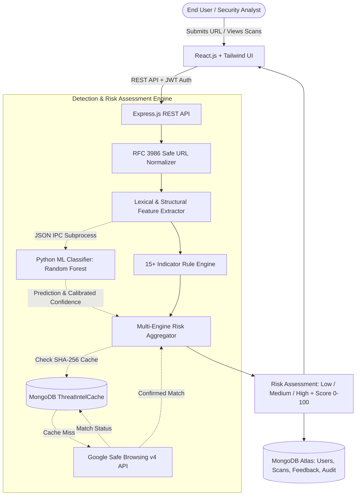

# PhishGuard: Phishing URL & Malware Detection System
**Academic Lab Project for MongoDB / Database Management Systems (DBMS)**  
**Developer:** Ayush Kumar &bull; **Stack:** MERN (MongoDB, Express, React, Node.js) + Python Machine Learning

[](https://nodejs.org/)
[](https://react.dev/)
[](https://expressjs.com/)
[](https://www.mongodb.com/)
[](https://scikit-learn.org/)
[](https://tailwindcss.com/)

---

## 1. Project Overview

**PhishGuard** is a full-stack cybersecurity web application built for semester evaluation in the **MongoDB / Database Management Systems** course. It analyzes suspicious links for phishing attempts, fake login portals, and dangerous file download payloads (ransomware droppers, executables, macros, Android APKs).

### Key Features
1. **Multi-Layer Detection Engine:** Combines 15+ heuristic security rules with a trained Scikit-Learn Random Forest ML classifier.
2. **Deep Payload & Harm Forensics:** Identifies dangerous file extensions (`.iso`, `.exe`, `.docm`, `.apk`, `.scr`, `.bat`), details specific damage to victim computers, and maps techniques to the MITRE ATT&CK framework.
3. **MongoDB Document Storage:** Stores complete, polymorphic forensic scan reports with subdocuments for indicators and threat profiles.
4. **Interactive Analytics:** Generates real-time charts using native MongoDB Aggregation Pipelines (`$group`, `$dateToString`, `$unwind`, `$cond`).

---

## 2. MongoDB Implementation & Architecture

> This project is designed specifically to showcase MongoDB's NoSQL document model, indexing, and aggregation capabilities:

### A. Why MongoDB (NoSQL) was Chosen Over Relational SQL
- **Polymorphic Threat Data:** Security scans produce varying numbers of triggered indicators (from 0 to 15+) and different payload metadata (e.g. Windows `.iso` container vs Android `.apk`). In relational SQL, this requires 4-5 tables with expensive foreign-key JOINs. In MongoDB, an entire scan is stored in a single document with zero JOIN overhead.
- **Embedded Subdocuments:** Threat profiles and indicator arrays are embedded directly inside the `Scan` record, ensuring atomic reads and writes.
- **Schema Flexibility:** Adding new forensic features (like MITRE ATT&CK techniques or payload details) requires zero schema migrations or table alters.

### B. MongoDB Collections & Schemas
| Collection | Schema Model | Purpose & Key Features |
| :--- | :--- | :--- |
| `scans` | [`Scan.js`](backend/src/models/Scan.js) | Stores scan history, normalized URL, composite risk score, embedded `indicators` array, and nested `threatProfile`. Compound indexes on `{ hostname: 1, scannedAt: -1 }` and `{ userId: 1, scannedAt: -1 }`. |
| `users` | [`User.js`](backend/src/models/User.js) | Stores user accounts with bcrypt password hashes and roles (`user`, `admin`). Unique index on `email`. |
| `feedbacks` | [`Feedback.js`](backend/src/models/Feedback.js) | User reports on false positives/negatives, referencing `scans` via Mongoose `ObjectId` (`ref: 'Scan'`). |
| `threatintelcaches` | [`ThreatIntelCache.js`](backend/src/models/ThreatIntelCache.js) | SHA-256 masked threat intelligence cache featuring a **MongoDB TTL (Time-To-Live) index** for automatic document expiration. |

### C. MongoDB Aggregation Pipelines Used
The analytics engine in [`analyticsController.js`](backend/src/controllers/analyticsController.js) uses native MongoDB aggregation pipelines:
```javascript
// 1. Group by risk category and calculate average score
await Scan.aggregate([
  {
    $group: {
      _id: '$riskCategory',
      count: { $sum: 1 },
      avgScore: { $avg: '$riskScore' }
    }
  }
]);

// 2. Unwind indicator arrays to rank top triggered threats
await Scan.aggregate([
  { $unwind: '$indicators' },
  { $group: { _id: '$indicators.name', count: { $sum: 1 } } },
  { $sort: { count: -1 } },
  { $limit: 5 }
]);

// 3. Temporal 7-day scan trends with conditional counting
await Scan.aggregate([
  { $match: { scannedAt: { $gte: sevenDaysAgo } } },
  {
    $group: {
      _id: { $dateToString: { format: '%Y-%m-%d', date: '$scannedAt' } },
      total: { $sum: 1 },
      highRisk: { $sum: { $cond: [{ $eq: ['$riskCategory', 'high'] }, 1, 0] } }
    }
  }
]);
```

### D. MongoDB Indexing Strategy
- **Compound Index:** `scanSchema.index({ hostname: 1, scannedAt: -1 })` — accelerates domain history and audit queries.
- **TTL Index:** `threatIntelCacheSchema.index({ expiresAt: 1 }, { expireAfterSeconds: 0 })` — automatically purges stale threat intelligence cache records without manual cron cleanup.

---

## 2. System Architecture



---

## 3. Technology Stack

- **Frontend:** React 18, Vite, Tailwind CSS, Lucide React, Recharts, Axios, React Router v7.
- **Backend:** Node.js, Express.js, Mongoose ODM, bcryptjs, jsonwebtoken, helmet, express-rate-limit, express-validator.
- **Database:** MongoDB Atlas (with in-memory standalone fallback for zero-friction local testing).
- **Machine Learning:** Python 3, scikit-learn, NumPy, joblib, standard `csv` & `urllib.parse`.
- **Hosting Targets:** Vercel (Frontend), Render (Backend), MongoDB Atlas (Database).

---

## 4. Repository Structure

```
.
├── backend/
│   ├── src/
│   │   ├── config/          # db.js (Atlas & memory failover), env.js
│   │   ├── controllers/     # auth, scan, analytics, feedback, admin controllers
│   │   ├── middleware/      # auth, rateLimiter, errorHandler
│   │   ├── models/          # User, Scan, ThreatIntelCache, Feedback, AuditLog
│   │   ├── routes/          # authRoutes, scanRoutes, analyticsRoutes, feedbackRoutes, adminRoutes
│   │   ├── services/        # ruleEngine.js, mlService.js, threatIntelService.js
│   │   ├── utils/           # urlNormalizer.js, seedData.js
│   │   ├── app.js
│   │   └── server.js
│   ├── tests/               # Jest & Supertest test suites
│   ├── .env.example
│   └── package.json
├── frontend/
│   ├── src/
│   │   ├── api/             # Axios client & interceptors
│   │   ├── components/      # Navbar, Footer, RiskGauge, IndicatorList, ScanResultCard
│   │   ├── context/         # AuthContext
│   │   ├── pages/           # Landing, Scanner, History, ScanDetail, Analytics, Login, Register, Profile, Admin, 404
│   │   ├── App.jsx
│   │   ├── index.css
│   │   └── main.jsx
│   ├── vite.config.js
│   ├── tailwind.config.js
│   └── package.json
├── ml/
│   ├── data/                # dataset.csv, generate_dataset.py
│   ├── models/              # phishing_model.joblib, scaler.joblib, model_metadata.json
│   ├── src/                 # feature_extraction.py, train.py, predict.py
│   └── requirements.txt
├── package.json
└── README.md
```

---

## 5. Prerequisites & Environment Setup

### Prerequisites
- Node.js >= 18.x (tested on v24.11.1)
- Python >= 3.10 (tested on v3.13.1)
- MongoDB Atlas cluster URI (optional: runs in memory fallback if URI is omitted)

### Step 1: Install Dependencies
```bash
# Backend dependencies
cd backend
npm install

# Frontend dependencies
cd ../frontend
npm install

# Python ML dependencies
cd ..
pip install -r ml/requirements.txt
```

### Step 2: Configure Environment Variables
Create `backend/.env` based on `backend/.env.example`:

```env
PORT=5000
NODE_ENV=development

# MongoDB Atlas URI (replace with your cluster connection string)
MONGODB_URI=mongodb+srv://<username>:<password>@cluster0.mongodb.net/phishguard?retryWrites=true&w=majority
USE_MEMORY_DB_FALLBACK=true

# JWT Authentication
JWT_SECRET=super_secret_64_character_encryption_key_for_jwt_session
JWT_EXPIRES_IN=7d
COOKIE_SECURE=false

# CORS
FRONTEND_URL=http://localhost:5173

# Optional: Google Safe Browsing API v4 Key (leave blank for heuristic & ML mode)
GOOGLE_SAFE_BROWSING_API_KEY=

# ML Service Settings
PYTHON_PATH=python
```

---

## 6. Running the Application

### Option A: Run Both Frontend and Backend Concurrently
From the root directory:
```bash
npm run dev
```

### Option B: Run Separately in Individual Terminals
**Terminal 1 (Backend REST API):**
```bash
cd backend
npm run dev
# Server will listen on http://localhost:5000
# Health check available at: http://localhost:5000/api/health
```

**Terminal 2 (Frontend Dev Server):**
```bash
cd frontend
npm run dev
# Vite server will launch at: http://localhost:5173
```

---

## 7. Machine Learning Pipeline

Train, evaluate, and inspect the classifier:
```bash
# Generate balanced dataset (300 legitimate, 300 phishing samples)
python ml/data/generate_dataset.py

# Train Random Forest vs Logistic Regression models
python ml/src/train.py

# Run standalone CLI prediction
python ml/src/predict.py --url "http://paypal.verify-account-security-alert.xyz/login.php"
```

---

## 8. Running Automated Tests

Run the comprehensive unit, integration, and security test suite:
```bash
cd backend
npm test
```
**Test Coverage Includes:**
- URL normalization & RFC 3986 compliance
- Heuristic indicator detection & calibrated risk scoring
- MongoDB Schemas & scan history pagination
- Machine learning subprocess execution & probabilistic failover
- Threat intelligence caching & API failure tolerance
- User registration, password hashing, and role-based access control (RBAC)
- Cross-user scan ownership boundaries

---

## 9. REST API Reference

| Method | Endpoint | Access | Description |
|---|---|---|---|
| `GET` | `/api/health` | Public | System status, database connection, and uptime |
| `POST` | `/api/scans` | Public / Optional Auth | Analyze a URL and return full assessment |
| `GET` | `/api/scans` | Public / Authenticated | Retrieve scan history with domain search & category filters |
| `GET` | `/api/scans/:id` | Public / Owner Protected | Retrieve individual scan forensic report |
| `DELETE` | `/api/scans/:id` | Protected (Owner/Admin) | Delete a private scan record |
| `GET` | `/api/scans/export/csv` | Public / Authenticated | Export scan history as a downloaded CSV file |
| `GET` | `/api/analytics/summary` | Public | Total scans, risk distributions, and average risk score |
| `GET` | `/api/analytics/trends` | Public | 7-day scan trends, top flagged domains & indicators |
| `POST` | `/api/auth/register` | Public | Register new security analyst |
| `POST` | `/api/auth/login` | Public | Authenticate user & issue JWT |
| `POST` | `/api/auth/logout` | Public | Invalidate authentication cookie |
| `GET` | `/api/auth/me` | Protected | Get profile of authenticated user |
| `POST` | `/api/feedback` | Public / Optional Auth | Submit false positive / false negative report |
| `GET` | `/api/admin/users` | Admin Only | View roster of registered analysts |
| `GET` | `/api/admin/model-metrics` | Admin Only | View ML classification metrics and confusion matrix |
| `GET` | `/api/admin/feedback` | Admin Only | View user false assessment reports |
| `PATCH` | `/api/admin/feedback/:id` | Admin Only | Update report status (`reviewed`, `dismissed`) |

---

## 10. Deployment Guide

### A. Deploy Frontend on Vercel
1. Link your GitHub repository to Vercel.
2. Set **Root Directory** to `frontend`.
3. Set **Build Command** to `npm run build` and **Output Directory** to `dist`.
4. Configure Environment Variable:
   - `VITE_API_BASE_URL`: `https://your-backend.onrender.com/api`

### B. Deploy Backend on Render
1. Create a **Web Service** on Render pointing to your repository.
2. Set **Root Directory** to `backend`.
3. Set **Build Command** to `npm install` and **Start Command** to `node src/server.js`.
4. Configure Environment Variables:
   - `NODE_ENV`: `production`
   - `PORT`: `5000`
   - `MONGODB_URI`: `mongodb+srv://<username>:<password>@cluster0.mongodb.net/phishguard?retryWrites=true&w=majority`
   - `JWT_SECRET`: A 64-character random secret key
   - `FRONTEND_URL`: `https://your-phishguard-app.vercel.app`
   - `COOKIE_SECURE`: `true`
   - `GOOGLE_SAFE_BROWSING_API_KEY`: *(Optional)* Your Google Cloud API key

### C. Deploy Database on MongoDB Atlas
1. Create a free M0 cluster in your preferred AWS/GCP region.
2. Under **Network Access**, add `0.0.0.0/0` (or Render's outbound IPs).
3. Under **Database Access**, create a database user with Read/Write privileges.
4. Copy the connection string and set `MONGODB_URI` in Render's environment settings.

---

## 11. Security Implementation Highlights

- **Zero-SSRF Server Design:** The server never issues outbound HTTP GET requests or renders submitted URLs. Inspection is conducted purely via lexical analysis, feature extraction, and API reputation checks.
- **Input Sanitization & Constraints:** URLs are restricted to maximum 2048 characters to prevent ReDoS and memory bloat. Malformed non-web schemes (`javascript:`, `file:`, `data:`) are rejected immediately.
- **Rate Limiting:** Authentication endpoints are constrained to 20 attempts per 15 minutes; URL scanning is limited to 30 requests per minute per IP.
- **Hash-Masked Threat Intelligence:** URLs are SHA-256 hashed before cache insertion to prevent leaking sensitive URLs in cache logs.
